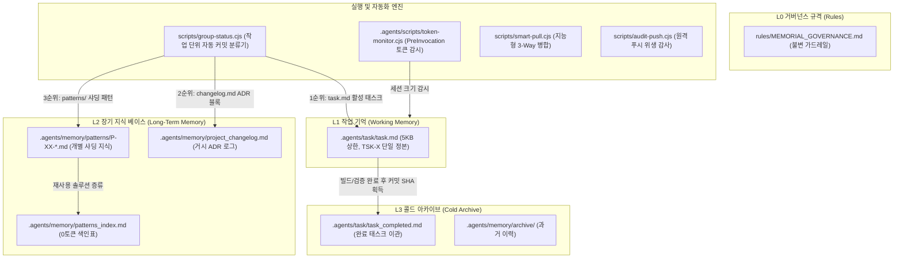

# Context Memorial System (3-Tier Memorial Model)

AI 코딩 에이전트 환경(Antigravity IDE, Claude Code, Cursor 등)에서 컨텍스트 윈도우 한계를 극복하고, 장기 지속 프로젝트의 지식 증류와 작업 단위(Task-Centric) 원자적 Git 형상 관리를 자동화하는 **3계층 인지 메모리얼 시스템(Three-Tier Memorial Model)** 보일러플레이트입니다.

---

## 1. 아키텍처 개요

본 시스템은 인간의 인지 구조(작업 기억, 장기 기억, 콜드 아카이브)와 소프트웨어 아키텍처 의사결정(ADR)을 결합하여, AI 에이전트의 컨텍스트 소모(토큰)를 0에 가깝게 유지하면서 무손실 지식 승격을 달성합니다.



---

## 2. 3계층 데이터 모델 상세

| 계층 | 대상 경로 | 역할 및 거버넌스 규칙 |
| :--- | :--- | :--- |
| **L1 (작업 기억)** | `.agents/task/task.md` | 현재 진행 중인 단일 활성 작업 상태 관리 정본. 파일 크기 **5KB 이하 유지**. 작업 식별자 `TSK-{자연수}` 체계(패딩 없음). |
| **L2 (장기 기억)** | `.agents/memory/patterns_index.md`<br>`.agents/memory/patterns/`<br>`.agents/memory/project_changelog.md` | **0토큰 Grep 원칙**: 전체 통조회 금지, 색인표를 통해 키워드로 선별 Grep 후 매칭된 `P-XX` 파일만 핀포인트 로딩.<br>**ADR 로그**: 거시 아키텍처 결정 사항만 최상단 prepend(`LOG-XX`). |
| **L3 (콜드 아카이브)** | `.agents/task/task_completed.md`<br>`.agents/memory/archive/` | 실제 커밋 SHA를 확보한 태스크만 이관하여 영구 보관. 일자별 섹션 헤더 및 커밋 해시 필수 명기. |

---

## 3. 핵심 자동화 도구

외부 npm 패키지 의존성 없이 **Node.js 내장 모듈**만으로 작동합니다.

### 1) `scripts/group-status.cjs` (작업 단위 커밋 엔진)
Git 워킹 트리의 변경된 파일들을 메모리얼 시스템의 정본 문서들과 대조하여 작업 단위(Task-Centric)로 자동 그룹화하고 개별 원자 커밋을 실행합니다.
- **분류 우선순위**:
  1. `task.md` 내의 `[커밋 대기]` 또는 `[진행 중]` 활성 작업의 대상 영역과 파일 경로 매칭
  2. `project_changelog.md` 최근 일자별 블록에 기재된 파일 매칭
  3. `patterns_index.md` 및 `patterns/` 샤딩 파일 내 언급된 파일 매칭
  4. 잔여 파일 성격별(전역 설정, 문서, UI 등) 보조 그룹화
- **실행 옵션**:
  ```bash
  node scripts/group-status.cjs             # 대화형 메뉴로 작업 선택 후 원자적 커밋
  node scripts/group-status.cjs --dry-run   # 커밋 없이 작업별 분류 및 커밋 메시지 미리보기
  node scripts/group-status.cjs --compact   # AI 에이전트용 1줄 압축 요약 출력 (토큰 절약)
  node scripts/group-status.cjs --commit=1  # 특정 작업 번호/TSK ID 단일 커밋 실행
  node scripts/group-status.cjs --all       # 감지된 모든 작업을 순차적으로 자동 개별 커밋
  ```

### 2) `.agents/scripts/token-monitor.cjs` (세션 토큰 감시)
Antigravity IDE의 `hooks.json` PreInvocation 훅과 연동하여, 에이전트 세션의 누적 트랜스크립트 크기를 모니터링하고 임계치 초과 시 경고를 주입합니다.

### 3) `scripts/install-template.cjs` & `scripts/sync-agent-rules.cjs` (멀티 에이전트 원클릭 인스톨러)
순수 배포 자산인 `cms_template/`의 구조를 대상 프로젝트로 자동 복제하고, 대상 `package.json`에 `git:*` 명령어 체계를 한 번에 주입합니다.
- **스캔 우선 에이전트 규칙 연동**:
  1. 대상 프로젝트에 이미 존재하는 규칙 파일(`CLAUDE.md`, `GEMINI.md`, `AGENTS.md`, `.cursorrules`, `.windsurfrules`)을 우선 자동 스캔하여 감지된 모든 파일에 3계층 거버넌스를 즉시 주입합니다.
  2. 규칙 파일이 감지되지 않는 경우에 한해, 터미널 대화형 프롬프트를 통해 사용할 에이전트 규칙 파일명을 사용자에게 질의(기본값: `AGENTS.md`)합니다.
  3. `--rule-file=<파일명>` 옵션을 통해 임의의 커스텀 규칙 파일명을 직접 지정하여 비대화형 자동 배포도 지원합니다.
  4. 모든 주입은 마커 태그(`<!-- CMS_GOVERNANCE_START -->`)를 사용하여 기존 사용자 규칙을 100% 보존합니다.

### 4) `scripts/uninstall-template.cjs` & `scripts/cms-manifest.cjs` (단일 매니페스트 기반 안전 롤백 엔진)
`scripts/cms-manifest.cjs`에 선언된 주입 명세를 바탕으로, 설치된 CMS 자산(.agents, scripts, rules, package.json 커맨드, .gitignore 항목)을 핀포인트로 선별 제거하고 대상 프로젝트를 원본 상태로 안전 복원합니다.
- **내용 변조 감지(Drift Detection)**: 에이전트 규칙 파일의 마커 내부 텍스트를 원본과 정밀 대조하여, 사용자가 수정한 내용이 감지되면 대화형으로 삭제 여부를 질의하고 임의 훼손을 차단합니다.
- **사용자 자산 보존**: `scripts/` 내 다른 사용자 스크립트나 `.gitignore` 내 기존 엔트리는 100% 보존합니다.
- **안전 스냅샷**: 작업 기억/패턴이 소실되지 않도록 `.agents` 디렉터리를 타임스탬프 백업(`.agents_backup_{timestamp}`) 후 제거합니다.

### 5) `scripts/smart-pull.cjs` & `scripts/audit-push.cjs`
- `smart-pull.cjs`: 원격 브랜치 변경사항을 당겨올 때 로컬 활성 작업(`task.md`)과의 충돌을 선제 차단하는 지능형 풀 및 해결 도구.
- `audit-push.cjs`: 원격 저장소 푸시 전 임시 파일, 테스트 코드, 미해결 충돌 마커 잔재를 정적 검사.

---

## 4. 패키지 아키텍처: 배포 자산과 도그푸딩 환경의 분리

본 저장소는 배포용 클린 템플릿과 본 패키지 자체의 개발 환경이 완벽히 격리되어 있습니다.

```
context_memorial_system_bundle/
├── cms_template/       # [배포 자산] 신규 프로젝트에 순수 복사될 클린 보일러플레이트
│   ├── .agents/        # 클린 태스크(TSK-1 온보딩 샘플), 색인표, 훅
│   ├── rules/          # 불변 거버넌스 규격 (MEMORIAL_GOVERNANCE.md)
│   └── scripts/        # 6대 실행 엔진 (group-status, smart-pull, audit-push, sync-agent-rules, cms-manifest, uninstall-template)
├── .agents/            # [자체 개발] 본 번들 자체의 실시간 작업 기억 (Dogfooding)
├── bin/                # 통합 CLI 진입점 (context-memorial.js)
├── scripts/            # 본 번들 도구 및 설치/제거 스크립트 (install-template.cjs, uninstall-template.cjs 등)
└── package.json        # 본 번들 매니페스트 ("cms:install", "cms:uninstall", "git:status" 등)
```

---

## 5. 신규 프로젝트 적용 퀵스타트

### 방법 A. npx CLI 실행 (가장 간편한 방법)
신규 또는 기존 프로젝트 디렉터리에서 즉시 실행합니다:
```bash
# 기본 실행: 기존 에이전트 규칙 파일 자동 스캔 (부재 시 질의)
npx context-memorial init

# 특정 디렉터리에 설치 및 특정 에이전트 규칙 파일 직접 지정
npx context-memorial init ./my-project --rule-file=CLAUDE.md

# 기존 파일 강제 덮어쓰기 모드
npx context-memorial init --force
```

### 방법 B. 로컬 번들 인스톨러 실행
본 저장소 터미널에서 대상 프로젝트 디렉터리를 지정하여 설치합니다:
```bash
# 대상 프로젝트에 템플릿 복제 및 규칙 자동 주입
node scripts/install-template.cjs /path/to/my-project

# 특정 규칙 파일 지정 설치
node scripts/install-template.cjs /path/to/my-project --rule-file=CLAUDE.md,GEMINI.md
```

### 방법 C. 수동 복사
1. `cms_template/` 디렉터리 내의 `.agents/`, `rules/`, `scripts/`를 신규 프로젝트 루트로 복사합니다.
2. 대상 프로젝트 `package.json`의 `scripts` 섹션에 다음 명령어를 등록합니다:
   ```json
   "scripts": {
     "git:status": "node scripts/group-status.cjs",
     "git:commit": "node scripts/group-status.cjs --all",
     "git:pull": "node scripts/smart-pull.cjs",
     "git:resolve": "node scripts/smart-pull.cjs --resolve",
     "git:audit-push": "node scripts/audit-push.cjs"
   }
   ```
3. 사용 중인 AI 에이전트 규칙 파일(`CLAUDE.md`, `GEMINI.md`, `AGENTS.md` 등)에 `rules/MEMORIAL_GOVERNANCE.md` 참조 명세를 주입합니다.
4. 대상 프로젝트 터미널에서 `npm run git:status`를 실행하여 3계층 메모리얼 시스템을 시작합니다.

---

## 6. 패키지 제거 및 안전 롤백 (Uninstall)

Context Memorial System을 프로젝트에서 안전하게 제거하고 설치 이전 상태로 원복합니다:

```bash
# 시뮬레이션: 실제 파일 변경 없이 삭제 대상 및 영향 범위 미리보기
npx context-memorial uninstall --dry-run

# 대화형 제거: 삭제 항목 안내 및 백업 생성 후 안전 제거
npx context-memorial uninstall

# 특정 디렉터리 지정 및 확인 프롬프트 생략 강제 실행
npx context-memorial uninstall ./my-project --force

# 백업 생성 없이 즉시 제거
npx context-memorial uninstall --no-backup
```

