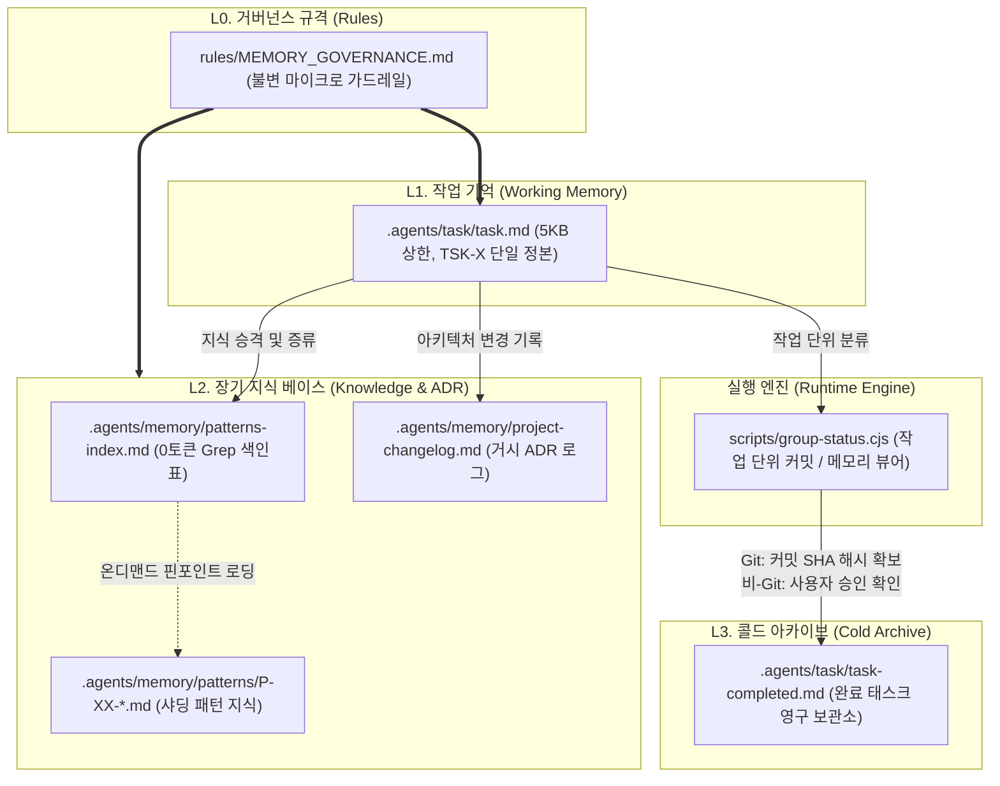
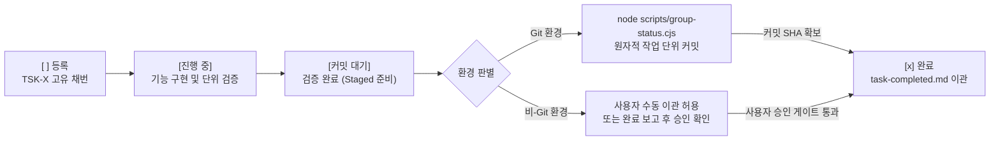

# Agent Context Memory (ACM)

Production-grade Three-Tier Context Memory & Task-Centric Git Engine for AI Coding Agents.

AI 코딩 에이전트(Antigravity IDE, Claude Code, Cursor, Windsurf, Codex, Copilot 등) 환경에서 컨텍스트 윈도우 한계로 인한 기억 소실(Context Amnesia)과 대규모 일괄 커밋(`git add .`)으로 인한 형상 관리 오염을 원천 차단하는 **3계층 인지 메모리 거버넌스 시스템(Three-Tier Memory Model)**입니다.

Git 환경과의 완벽한 유기적 결합(원자적 자동 분할 커밋, 지능형 3-Way 병합)은 물론, **Git이 없는 환경(Git 미설치 또는 비-저장소 디렉터리)에서도 크래시 없이 100% 가동되는 메모리 뷰어 및 사용자 승인 게이트(Graceful Fallback)**를 제공합니다.

---

## 1. 아키텍처 개요 및 라이프사이클

본 시스템은 인간의 인지 구조(작업 기억, 장기 기억, 콜드 아카이브)와 소프트웨어 아키텍처 의사결정(ADR)을 결합하여, AI 에이전트의 컨텍스트 소모(토큰)를 0에 가깝게 유지하면서 무손실 지식 승격과 원자적 형상 관리를 달성합니다.



### 작업 라이프사이클 파이프라인



---

## 2. 빠른 시작 (Quick Start)

외부 npm 의존성이 전혀 없는 **Node.js 18+ 순수 내장 모듈**로 작동합니다. 하나의 명령어로 모든 AI 코딩 에이전트 환경에 즉시 설치할 수 있습니다.

### 방법 A. npx CLI 실행 (가장 권장하는 표준 방법)

신규 또는 기존 프로젝트 디렉터리에서 즉시 실행합니다:

```bash
# 기본 실행: 프로젝트 내 기존 에이전트 규칙 파일 자동 스캔 및 3계층 거버넌스 주입
npx agent-context-memory init

# 특정 프로젝트 디렉터리에 설치
npx agent-context-memory init ./my-project

# 특정 에이전트 규칙 파일 직접 지정 (쉼표 구분 다중 지정 가능)
npx agent-context-memory init ./my-project --rule-file=CLAUDE.md

# 기존 템플릿 파일 강제 덮어쓰기 모드
npx agent-context-memory init --force
```

### 방법 B. 전역 설치 (Global CLI)

CLI 단축어(`acm`)를 전역 터미널에서 사용하고자 할 경우:

```bash
# 전역 설치
npm install -g agent-context-memory

# 단축 명령어로 초기화
acm init
acm status
```

### 방법 C. 로컬 번들 인스톨러 직접 실행

본 저장소를 클론한 로컬 환경에서 대상 프로젝트로 직접 주입할 경우:

```bash
# 대상 프로젝트에 템플릿 복제 및 규칙 주입
node scripts/install-template.cjs /path/to/my-project

# 특정 규칙 파일 지정 설치
node scripts/install-template.cjs /path/to/my-project --rule-file=CLAUDE.md,GEMINI.md
```

---

## 3. 멀티 에이전트 호환성 매트릭스 (Multi-Agent Support)

`agent-context-memory`는 특정 IDE나 단일 AI 도구에 종속되지 않습니다. 프로젝트 루트의 규칙 파일을 자동 감지하여 마커 기반(`<!-- ACM_GOVERNANCE_START -->`)으로 비파괴 주입됩니다.

| AI 에이전트 환경 | 대상 규칙 파일 | 연동 방식 및 기능 지원 |
| :--- | :--- | :--- |
| **Antigravity IDE** | `AGENTS.md` / `GEMINI.md` | `.agents/` 네이티브 작업 기억, `hooks.json` 세션 토큰 감시, `skills/` 연동 |
| **Claude Code** | `CLAUDE.md` | 프로젝트 가드레일 자동 주입, `scripts/group-status.cjs` 원자 커밋 워크플로 |
| **Cursor** | `.cursorrules` / `.cursor/rules/*.mdc` | 3계층 메모리 규칙 주입, 5KB 상한 작업 기억 단일 정본 연동 |
| **Windsurf** | `.windsurfrules` | Cascade 엔진 가드레일 자동 반영, 작업 상태 기반 컨텍스트 정렬 |
| **Codex / Copilot** | `AGENTS.md` / `.github/copilot-instructions.md` | 프로젝트 표준 거버넌스 및 ADR 기반 히스토리 추적 |
| **OpenCode** | `AGENTS.md` | 표준 마크다운 프롬프트 인터페이스 및 0토큰 Grep 지식 탐색 |

---

## 4. 왜 Agent Context Memory인가? (Why ACM?)

### 1) 컨텍스트 고갈과 기억 소실(Context Amnesia) 해결
- **문제**: AI 에이전트는 대화가 길어지면 과거 결정 사항을 망각하고, 수만 줄의 문서를 통째로 읽어 토큰을 낭비합니다.
- **해결**: 엄격한 **5KB 상한 작업 기억(`task.md`)**과 키워드 색인표(`patterns-index.md`)를 통한 **0토큰 Grep 원칙**을 강제합니다. 전체 문서를 읽지 않고 필요한 패턴 파일만 핀포인트 로딩합니다.

### 2) 대규모 일괄 커밋(`git add .`)과 형상 관리 오염 차단
- **문제**: 에이전트에게 커밋을 맡기면 변경된 수십 개의 파일을 한꺼번에 스테이징하여 코드 리뷰와 롤백을 불가능하게 만듭니다.
- **해결**: `scripts/group-status.cjs` 커밋 엔진이 `task.md`의 활성 작업 번호(`TSK-X`), ADR 로그, 패턴 파일을 대조하여 **작업 단위(Task-Centric)로 변경사항을 자동 분할 커밋**합니다.

### 3) 검증 전 조기 완료 오판 방지 및 무결성 게이트 (Negative Rule & Approval Gate)
- **문제**: AI 에이전트는 코드를 작성하자마자 "작업 완료"로 표시하고 기억을 지워버리는 실수를 반복합니다.
- **해결**: 상태 라이프사이클에 `[커밋 대기]` 단계를 강제하고 이관 무결성 게이트를 적용합니다:
  - **Git 환경**: 실제 터미널 Git 커밋 SHA 해시를 획득하기 전에는 콜드 아카이브(`task-completed.md`) 이관을 원천 차단합니다.
  - **비-Git 환경**: 에이전트의 임의 조기 이관을 금지하며, 사용자의 수동 이관 허용 및 에이전트 작업 완료 시 **반드시 사용자에게 검증 결과 보고와 함께 완료 이관 여부를 확인(승인)**받은 후 이관하도록 통제합니다.

### 4) 완전한 가역성 (100% Safe Uninstall)
- **문제**: 보일러플레이트나 플러그인 도입 시 프로젝트 원본 파일이 훼손되거나 잔재 파일이 남습니다.
- **해결**: `scripts/acm-manifest.cjs` 단일 정본 매니페스트와 내용 변조 감지(Drift Detection) 엔진을 탑재하여, `npx agent-context-memory uninstall` 실행 시 사용자의 원본 파일을 단 1바이트의 오차도 없이 원상 복구합니다.

### 5) 비-Git 환경 무장애 가동 (Zero-Dependency & Graceful Fallback)
- **문제**: Git 전용 자동화 도구들은 Git이 설치되지 않았거나 비저장소 디렉터리에서 실행 시 즉시 크래시되어 전체 작업이 중단됩니다.
- **해결**: 2단계 정밀 환경 진단 엔진(`scripts/check-git.cjs`)을 통해 비-Git 환경을 자동 감지하며, 상태 점검 도구는 **비-Git 메모리 뷰어 모드로 자동 전환**되어 활성 태스크, 최근 변경 이력, 축적 패턴을 정상 리포트합니다. Git 전용 조작은 안전하게 우아한 건너뛰기 처리됩니다.

---

## 5. 3계층 데이터 모델 상세 규격

| 계층 | 대상 경로 | 최대 용량 | 역할 및 거버넌스 규격 |
| :--- | :--- | :--- | :--- |
| **L0 (규칙 계층)** | `rules/MEMORY_GOVERNANCE.md`<br>에이전트 규칙 파일 | 약 70토큰 | 불변의 핵심 5대 원칙(Micro-Guardrail) 상시 주입 및 세부 규격 정의 |
| **L1 (작업 기억)** | `.agents/task/task.md` | **5KB 이하** | 현재 활성화된 단일 작업의 정본. `TSK-{자연수}` 영구 불변 식별자 체계. |
| **L2 (장기 지식)** | `.agents/memory/patterns-index.md`<br>`.agents/memory/patterns/P-XX-*.md`<br>`.agents/memory/project-changelog.md` | 샤드당 2KB<br>(분산 저장) | **0토큰 Grep 원칙**: 전체 통조회 금지, 색인표 키워드 매칭 파일만 조회.<br>**거시 ADR 로그**: 시스템 설계 변경 사항만 최상단 prepend(`LOG-XX`). |
| **L3 (콜드 아카이브)** | `.agents/task/task-completed.md`<br>`.agents/memory/archive/` | 무제한 | Git 커밋 SHA 해시(Git 환경) 또는 사용자 승인 완료 표기(비-Git 환경)를 확보한 완료 작업만 일자별로 이관 보관. |

---

## 6. 핵심 실행 엔진 및 명령어 가이드

### 1) CLI 명령어

```bash
# 템플릿 설치 및 프로젝트 초기화 (비-Git 환경 비차단 설치 지원)
npx agent-context-memory init [경로] [옵션]

# 작업 단위 상태 점검 (Git 환경: 파일 변경 감지 / 비-Git 환경: 3계층 메모리 뷰어)
npx agent-context-memory status
npx agent-context-memory status --compact

# 작업 단위 개별 원자 커밋 실행 (비-Git 환경: 안전 안내 및 수동 이관 가이드)
npx agent-context-memory commit
npx agent-context-memory commit --commit=1

# 원격 브랜치 변경사항 지능형 3-Way 병합 (Git 환경 전용, 비-Git 환경: 안전 건너뛰기)
npx agent-context-memory pull

# 3-Way 충돌 정밀 하이브리드 결합 완결
npx agent-context-memory resolve

# 원격 브랜치 푸시 전 위생 및 정적 감사
npx agent-context-memory audit

# 현재 환경의 Git 설치 유무 및 대상 디렉터리 저장소 여부 2단계 정밀 진단
npx agent-context-memory check-git

# ACM 자산 안전 롤백 및 제거 (시뮬레이션: --dry-run)
npx agent-context-memory uninstall [경로] [옵션]
```

### 2) 작업 단위 Git 자동화 스크립트 (`package.json`)

설치 완료 후 프로젝트의 `package.json`에 다음 스크립트가 자동 등록됩니다:

```bash
# 대화형 메뉴로 작업 선택 후 원자적 커밋 (비-Git 환경: 메모리 뷰어)
npm run git:status

# 감지된 모든 작업을 순차적으로 자동 개별 커밋
npm run git:commit

# 원격 브랜치 변경사항 당겨올 때 로컬 활성 작업 충돌 선제 차단 (지능형 풀)
npm run git:pull

# 3-Way 충돌 해결 마커 점검
npm run git:resolve

# 원격 푸시 전 임시 파일, 테스트 코드, 미해결 충돌 마커 정적 감사
npm run git:audit-push
```

---

## 7. 저장소 구조: 배포 자산과 개발 환경의 분리

본 저장소는 배포용 클린 템플릿(`acm-template/`)과 본 시스템 자체를 개발하는 환경(`.agents/`)이 완벽히 격리되어 있습니다.

```
agent-context-memory/
├── acm-template/       # [배포 자산] 신규 프로젝트에 주입될 클린 보일러플레이트
│   ├── .agents/        # 클린 태스크(TSK-1 온보딩 샘플), 색인표, 훅
│   │   ├── hooks.json  # Antigravity IDE 세션 토큰 감시 훅
│   │   ├── memory/     # 패턴 색인표(patterns-index.md), 샤딩 디렉터리
│   │   └── task/       # 작업 기억 단일 정본(task.md)
│   ├── rules/          # 불변 거버넌스 규격 (MEMORY_GOVERNANCE.md)
│   └── scripts/        # 6대 실행 엔진 (group-status, smart-pull, audit-push 등)
├── .agents/            # [자체 개발] 본 패키지 자체의 실시간 작업 기억 (Dogfooding)
├── bin/                # 통합 CLI 진입점 (agent-context-memory.js)
├── scripts/            # 인스톨러(install-template.cjs) 및 언인스톨러
├── rules/              # 거버넌스 표준 규격서
├── package.json        # 패키지 매니페스트
└── LICENSE             # MIT License
```

---

## 8. 기존 방식과의 비교 (Comparison)

| 비교 항목 | 기존 일반 방식 | Agent Context Memory (ACM) |
| :--- | :--- | :--- |
| **메모리 유지** | 대화 세션 종료 시 모든 컨텍스트 소실 | 3계층 모델을 통해 파일 시스템에 영구적 무손실 보존 |
| **토큰 소모량** | 매 턴마다 수천 줄의 가이드 문서 전체 주입 | 마이크로 가드레일(70토큰) 및 0토큰 Grep 핀포인트 로딩 |
| **작업 추적성** | 에이전트 임의 판단으로 "완료" 선언 후 망각 | `task.md` 5KB 상한 정본 유지, 커밋 SHA 획득 전 이관 차단 |
| **Git 커밋 품질** | `git add .`로 수십 개 파일 혼합 일괄 커밋 | 태스크 번호(`TSK-X`) 기반 파일 자동 분할 개별 원자 커밋 |
| **환경 유연성** | Git 미설치/비저장소 시 스크립트 크래시 발생 | 2단계 진단 엔진으로 비-Git 자동 감지, 메모리 뷰어 및 사용자 승인 게이트 가동 (Graceful Fallback) |
| **안전 롤백** | 설치 후 파일 삭제 시 프로젝트 파손 위험 | 매니페스트 기반 선별 제거 및 변조 감지(Drift Detection) 복원 |

---

## 9. 라이선스 및 기여 (License)

본 프로젝트는 [MIT License](LICENSE) 하에 오픈소스로 제공됩니다. 자유롭게 개인 또는 기업 프로젝트에 도입하고 확장할 수 있습니다.

- Author: Rock Beider
- Repository: [https://github.com/rockbeider/agent-context-memory](https://github.com/rockbeider/agent-context-memory)
