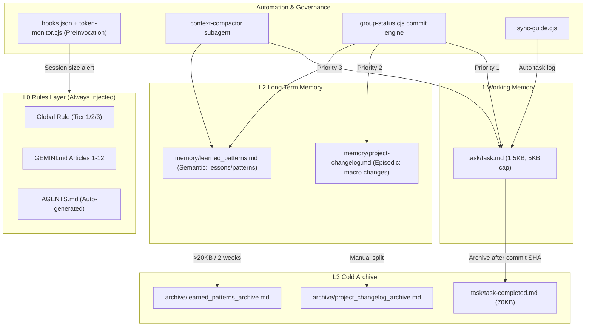

# Agent Context Memory (ACM) System Analysis

Baseline Date: 2026-10-19 / Scope: `GEMINI.md`, global rules, `.agents/`, `scripts/group-status.cjs`, `scripts/sync-guide.cjs`

---

## 1. Architecture Overview

| Tier | File | Growth Direction | Size | Role |
|---|---|---|---|---|
| L1 | `task.md` | State transitions | 1,537B / 1 active | Active task single source of truth |
| L2 | `learned_patterns.md` | **Bottom append** | 20,436B / 45 items | Troubleshooting patterns |
| L2 | `project-changelog.md` | **Top prepend** | 30,285B / 16 blocks | Macro architectural changes |
| L3 | `task-completed.md` | Top prepend | 70,309B / 717 lines | Completed task archive |
| L3 | `archive/*` | - | 19.9KB / 23.0KB | Historical archive (09-10 ~ 09-15) |

---

## 2. Design Strengths

- **Clear cognitive separation**: Rules (immutable) / Working memory (volatile) / Long-term memory (distilled) / Archive (cold).
- **Executable documentation**: `group-status.cjs` parses task/changelog/patterns to classify commits directly from memory docs.
- **State lifecycle + Negative Rule**: `[Ready]` and "never archive before obtaining a commit SHA" eliminate premature "build passed = done" mistakes.
- **Zero-token monitoring**: `token-monitor.cjs` checks transcript size in an OS subprocess without model tokens, adhering to the `transcriptPath` and `injectSteps[].ephemeralMessage` contract.
- **Bypass prefixes**: `/skip` and `/task` provide zero-cost fast paths when full pre-checks are unnecessary.
- **Lesson-to-rule promotion loop**: Concrete incidents (Git pager freezes, bulk commits, merge conflicts) were codified into automation scripts and rules.

---

## 3. Historical Defects & Risks Identified (Prioritized)

### [High] 3.1 Session-Start Slice Rule vs. Append Order Mismatch
- Reading only lines 1-40 works for top-prepended `project-changelog.md`, but bottom-appended `learned_patterns.md` puts the oldest entries at the top so recent lessons are never seen.

### [High] 3.2 Unbounded Growth & Manual-Only Compactor
- `learned_patterns.md` exceeded its 20KB threshold and `project-changelog.md` (30KB) / `task-completed.md` (70KB) had no automated archival triggers.

### [High] 3.3 Stale Memory Misclassification in Commit Engine
- `parseChangelog()` and `parseLearnedPatterns()` matched old backtick file paths without a time window, risking misclassification when `task.md` omitted targets.

### [Medium] 3.4 Non-Unique Per-Batch Task IDs
- Task numbers previously restarted from 1 per batch, breaking traceability across commits and archives.

### [Medium] 3.5 Missing Commit SHAs & Oversized Pattern Entries
- Historical `task-completed.md` contained 27 entries lacking commit SHAs, and pattern entries averaged 3-5 lines instead of concise 1-2 line summaries.

### [Medium] 3.6 Redundant Storage Across Rules, Patterns, and Changelogs
- Promoted lessons duplicated rule text, and changelogs duplicated task-level implementation details.

### [Low] 3.7-3.9 Multi-Writer Contention, Token Estimation Noise & Filename Drift
- Multiple writers lacked clear ownership, `token-monitor` repeatedly injected warnings on every turn after 200KB, and filenames drifted (`task_complete.md` vs `task-completed.md`).

---

## 4. Improvement Roadmap (Adopted Into Modern ACM)

| # | Target | Recommendation | Outcome |
|---|---|---|---|
| R1 | `patterns-index.md` + sharded `patterns/` | Replace monotonic log with lightweight index table + 5-line sharded files | Resolves 3.1 & 3.6 |
| R2 | `context-compactor` & `autoCompleteTask` | Automate task archiving on commit and roll over large logs | Resolves 3.2 |
| R3 | `group-status.cjs` | Enforce 14-day changelog window and strict `[Ready]` isolation | Resolves 3.3 |
| R4 | Global `TSK-{N}` IDs | Introduce immutable sequential IDs across tasks, commits, and archives | Resolves 3.4 |
| R5 | Pattern distillation rules | Enforce 5-line pattern format and separate promoted rules from patterns | Resolves 3.5 & 3.6 |
| R6 | ADR vs. task archive separation | Keep changelogs strictly for macro ADRs with top `ADR Index Map` | Eliminates duplication |
| R7 | `token-monitor.cjs` | Add MD5 tier-state caching to suppress duplicate warnings | Reduces hook noise |
