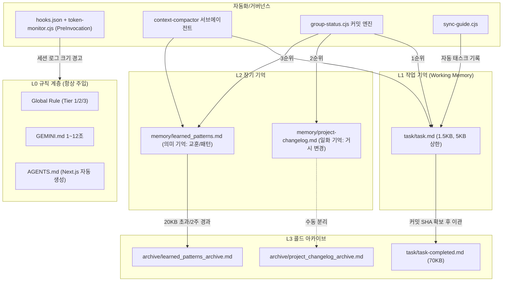

# Agent Context Memory (ACM) 시스템 분석

기준일: 2026-10-19 / 분석 대상: `GEMINI.md`, 글로벌 룰, `.agents/` 전체, `scripts/group-status.cjs`, `scripts/sync-guide.cjs`

---

## 1. 아키텍처 개요

| 계층 | 파일 | 갱신 방향 | 현재 크기 | 역할 |
|---|---|---|---|---|
| L1 | `task.md` | 상태 전이 | 1,537B / 활성 1건 | 단일 활성 작업 정본 |
| L2 | `learned_patterns.md` | **하단 append** | 20,436B / 45건 | 트러블슈팅 교훈 |
| L2 | `project-changelog.md` | **상단 prepend** | 30,285B / 16블록 | 거시 변경 이력 |
| L3 | `task-completed.md` | 상단 prepend | 70,309B / 717줄 | 완료 태스크 보관 |
| L3 | `archive/*` | - | 19.9KB / 23.0KB | 09-10~09-15 이력 (09-17 이후 미갱신) |

---

## 2. 설계 강점

- **계층 분리가 명확함**: 규칙(불변) / 작업기억(휘발) / 장기기억(증류) / 아카이브(콜드)로 인지 아키텍처와 유사한 구조.
- **메모리가 실행 가능한 데이터로 쓰임**: `group-status.cjs`가 task/changelog/patterns를 파싱해 커밋 그룹을 결정. 문서가 단순 기록이 아니라 커밋 엔진의 입력이 됨.
- **상태 라이프사이클 + Negative Rule**: `[커밋 대기]`와 "SHA 획득 전 이관 금지"로 "빌드 통과 = 완료" 오판을 차단 (패턴 #40의 실패 경험을 규칙으로 승격한 사례).
- **0토큰 감시**: `token-monitor.cjs`가 OS 프로세스로 transcript 크기만 측정해 경고. 훅 계약(`transcriptPath`, `injectSteps[].ephemeralMessage`)은 공식 규격과 일치.
- **바이패스 프리픽스**: `/스킵`, `/태스크`로 사전 조회 비용을 0으로 만드는 경로 제공.
- **교훈 → 규칙 승격 루프 존재**: 패턴 #27(Git pager), #41(작업 단위 커밋), #42(smart-pull)가 실제 스크립트/GEMINI.md 조항으로 반영됨.

---

## 3. 결함 및 리스크 (우선순위순)

### [High] 3.1 세션 시작 조회 규칙과 파일 정렬 방향 불일치
- GEMINI.md 9조: "상위 30~40라인만 조회".
- `project_changelog.md`는 **최신이 상단**이라 유효.
- `learned_patterns.md`는 **최신이 하단**(9조에서 "최하단에 기록" 명시). 상위 40줄 = 09-16~09-18의 **가장 오래된** 기록. 최근 교훈(#48~#51)은 세션 시작 시 절대 읽히지 않음.
- 9조 문구에 대상 파일이 명시되지 않아 해석이 에이전트마다 달라질 수 있음.

### [High] 3.2 압축 임계치 초과 상태 방치
- `learned_patterns.md` 20,436B > compactor 기준 20KB. 45건 중 31건이 09-16~09-17(4주 경과, "2주 경과 시 이관" 기준 위반).
- 아카이브는 09-17 이후 1개월간 미갱신. **compactor가 수동 호출 전용**이라 트리거되지 않음.
- `project_changelog.md`(30KB)와 `task_completed.md`(70KB)는 **어떤 압축 규칙도 적용받지 않음** (compactor 범위 밖).

### [High] 3.3 커밋 엔진의 오래된 메모리 오매칭 위험
- `parseChangelog()`는 제목에 `commit`이 없으면 매칭 후보로 유지. 현재 미커밋 표기 블록: 10-12(Task #3), 09-18, 09-17 x4 = **6개 블록이 상시 매칭 후보**.
- `parseLearnedPatterns()`는 백틱 경로가 있는 모든 패턴을 그룹 후보로 사용 (기간 제한 없음).
- 결과: task.md에 대상영역이 누락된 파일이 1개월 전 changelog/패턴 그룹으로 분류될 수 있음. 장기기억이 "현재 작업 분류기"로 오용되는 구조.

### [Medium] 3.4 태스크 식별자 비유일성
- 태스크 번호가 일자/배치별로 1부터 재시작. 예: `task_completed.md`의 **#5** 항목이 실제 커밋 메시지는 `6f9e594 ... [Task #2]`.
- `--commit=<번호>`, 커밋 메시지, 아카이브 간 추적성이 끊김.
- `task_completed.md` 날짜 섹션 헤더가 `## 1.` 이후 전부 `## 2.`로 고정 (단순 서식 결함).

### [Medium] 3.5 규칙 위반 잔존
- `task_completed.md` 내 `- [x]` 항목 중 **Commit 표기 없는 항목 27건** (11조: SHA 필수 명기).
- `learned_patterns.md` 9조 형식 "1~2줄 요약" 대비 평균 항목 길이 약 400자(실질 3~5줄).

### [Medium] 3.6 메모리 범주 혼재 (중복 저장)
- `learned_patterns.md`에 규칙성 메타 항목이 다수: #14, #20, #29, #36, #40, #41, #43 등. 이미 GEMINI.md 9~12조로 승격 완료된 내용이 중복 상주 -> 매 조회마다 이중 비용.
- `project_changelog.md`와 `task_completed.md`가 동일 작업을 서로 다른 상세도로 이중 기록 (예: 10-14 z-index 작업).

### [Low] 3.7 쓰기 주체 다중화
- `sync-guide.cjs`가 `task.md`에 자동 기록. 사람/에이전트/스크립트 3주체가 단일 정본을 수정 -> 5KB 상한, 번호 체계, 서식 일관성 보장 주체 불명확.

### [Low] 3.8 token-monitor 정밀도/노이즈
- 추정식 `sizeKB/3.5*1000`은 JSONL 메타 오버헤드와 한글 UTF-8(3B/자)을 반영하지 못해 과대 추정 경향.
- 200KB 초과 후 **매 호출마다** 동일 경고 주입 (쿨다운/중복 억제 없음).
- 측정 대상이 실제 모델 컨텍스트가 아닌 누적 로그 크기 -> 컨텍스트 압축이 일어난 세션에서도 계속 경고.

### [Low] 3.9 명칭 불일치
- 패턴 #36: `task_complete.md` / GEMINI.md: `task_completed.md`.

---

## 4. 개선 권고

| # | 대상 | 권고안 | 효과 |
|---|---|---|---|
| R1 | `learned_patterns.md` + 9조 | 최신 상단 prepend로 전환 (changelog와 방향 통일). 또는 9조에 "learned_patterns는 하위 40줄" 명시 | 3.1 해소 |
| R2 | compactor | 대상에 changelog(25KB), task_completed(분기/월별 파일 롤링) 추가. `token-monitor` 또는 `git:commit` 후처리에서 임계치 초과 시 compactor 호출 권고 메시지 주입 | 3.2 자동화 |
| R3 | `group-status.cjs` | changelog/pattern 매칭에 기간 창(예: 최근 14일) 적용, 또는 2·3순위 매칭 결과를 "제안"으로만 표시하고 확정은 task.md 1순위만 허용 | 3.3 오분류 차단 |
| R4 | 태스크 ID | 전역 증가 ID(예: `T-0142`) 도입, 커밋 메시지/아카이브/`--commit` 키 통일 | 3.4 추적성 |
| R5 | `learned_patterns.md` | 규칙 승격 완료 항목에 `[승격됨: GEMINI 12조]` 표기 후 아카이브 이동. 항목 형식을 "증상 -> 원인 -> 해법" 3필드 1줄로 강제 | 3.5, 3.6 |
| R6 | changelog vs task_completed | 역할 분리 명문화: task_completed=작업 단위 상세, changelog=아키텍처 결정만(ADR 성격, 블록당 10줄 이내) | 중복 제거 |
| R7 | token-monitor | 임계 구간 진입 시 1회만 경고(상태 파일 또는 구간 키 기록), 추정 계수 보정 | 노이즈 감소 |

> [!NOTE]
> R1/R3/R5는 소규모 수정(Tier 1~2), R2/R4는 스크립트 다수 연동으로 Tier 2 계획서 대상.
